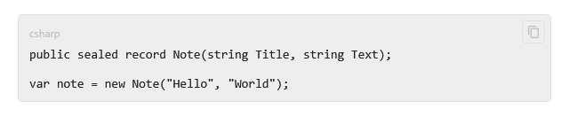

**English** | [Русский](Code-Blocks-ru)

A fenced code block gets a header with its language — the first word after the opening fence — and
monospace text that scrolls sideways instead of wrapping words. While the pointer is over the block,
a copy button shows in its corner. Code indented by four spaces is drawn the same way, without the
header. A block in `csv` or `tsv` can be drawn as a table by the ready-made
[tables from CSV](Kit-Media#tables-from-csv).



## The copy button

The button copies the whole code, whatever is selected: as plain text, as a Markdown code block and as
HTML `<pre><code class="language-…">`. Before that it raises `DataObject.Copying`, like the copying of
a selection — see [Copying](Copying#changing-what-is-copied). After a click the icon turns into a
check mark for a moment.

`ShowCodeCopyButton` hides the button. It is an inherited attached property: set it on a viewer, or
once on a window or a list of viewers.

**A window or a user control**:

```xml
<mdv:MarkdownViewer Markdown="{Binding Text}" ShowCodeCopyButton="False" />

<ItemsControl ItemsSource="{Binding Messages}" mdv:MarkdownViewer.ShowCodeCopyButton="False" />
```

The tooltip and the name for screen readers is the theme key `Md.CodeBlock.CopyToolTip`; the icons are
the `Geometry` keys `Md.CodeBlock.CopyIcon` and `Md.CodeBlock.CopiedIcon`. In a template of your own the
button is the part `PART_Copy`, and `CodeBlockPresenter.IsCopied` tells that the code has just been
copied.

## Line numbers inside code

`ShowCodeLineNumbers` numbers the lines of every code block from 1. It is inherited as well.

**A window or a user control**:

```xml
<mdv:MarkdownViewer Markdown="{Binding Text}" ShowCodeLineNumbers="True" />
```

Numbers of the source lines of the whole document are a separate feature — see
[Line Numbers](Line-Numbers).

## The look

Colors, font and frame are the keys `Md.CodeBlock.*` — see [Theming](Theming#all-keys). The template is
the style `Md.CodeBlock.Style` or the `CodeBlockTemplate` of a style provider — see
[Styles and Templates](Styles-and-Templates).

## Syntax highlighting

The viewer does not highlight syntax by itself. The language of a block is in `CodeBlockVm.Syntax`, so
you can add highlighting yourself: replace `CodeBlockTemplate` with a template around your highlighting control, or turn
blocks of one language into a widget of yours with an extension — see
[Extensions](Extensions#overriding-built-in-syntax). A block whose code is drawn without
`p:MdTextBlock` is selected as a whole.
