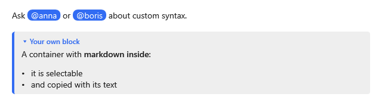

[English](Extensions) | **Русский**

Расширение учит вьюер своему синтаксису: добавляет конструкцию в разбор Markdig, превращает её узлы
в свои модели и даёт этим моделям шаблоны. Такая модель со своим шаблоном — **виджет**. Тем же
способом перекрывается и встроенный синтаксис.



## Устройство

Расширение — наследник `MdExtension`, который перекрывает то, что ему нужно:

| Член | Что делает |
|---|---|
| `SetupPipeline(builder)` | добавляет расширения и разборщики Markdig для своего синтаксиса |
| `ConvertBlock(block, context)` | превращает блок Markdig в свою модель блока; `null` — не свой |
| `ConvertInline(inline, context)` | превращает инлайн Markdig в свою строчную модель; `null` — не свой |
| `SelectTemplate(item, container)` | возвращает шаблон своей модели; `null` — не своя |
| `CreateState(node)` | создаёт состояние виджета, которое переживает его контрол; `null` — состояния нет |

Вьюер опрашивает расширения по порядку, раньше своего разбора и раньше провайдера стилей, так что
побеждает первое ответившее. `MdConvertContext` разбирает содержимое своего узла так же, как остальной
документ: `ConvertChildren` — вложенные блоки, `ConvertInlines` — строчное содержимое; `GetSource` и
`GetSpan` дают исходный текст и позицию узла.

Модели наследуются от `BlockVm` или `InlineVm`. Это записи, поэтому и свои модели — неизменяемые
записи.

## Блочный виджет

Заметка: свой контейнер `:::note Заголовок` с Markdown внутри. Свои контейнеры уже есть в стандартной
настройке разбора, поэтому расширение их только превращает.

**Любой `.md`-файл**:

```markdown
:::note Your own block
A container with **markdown inside**.
:::
```

**`NoteVm.cs`**:

```csharp
using MarkdigWpfViewer.Selection;
using MarkdigWpfViewer.ViewModels;

public sealed record NoteVm(string Title, IReadOnlyList<BlockVm> Blocks) : BlockVm, IMdTextSource
{
    public void WriteText(MdTextWriter writer)
    {
        writer.Text(Title);
        writer.Text("\n");
        writer.Blocks(Blocks);
    }
}
```

**`NoteExtension.cs`**:

```csharp
using System.Windows;
using Markdig.Extensions.CustomContainers;
using Markdig.Syntax;
using MarkdigWpfViewer.Extensions;
using MarkdigWpfViewer.ViewModels;

public sealed class NoteExtension : MdExtension
{
    public DataTemplate? Template { get; set; }

    public override BlockVm? ConvertBlock(Block block, MdConvertContext context)
        => block is CustomContainer { Info: "note" } container
            ? new NoteVm(container.Arguments ?? string.Empty, context.ConvertChildren(container))
            : null;

    public override DataTemplate? SelectTemplate(object item, DependencyObject container)
        => item is NoteVm ? Template : null;
}
```

**`MainWindow.xaml`**, вьюер:

```xml
<mdv:MarkdownViewer Markdown="{Binding Text}">
    <mdv:MarkdownViewer.Extensions>
        <local:NoteExtension>
            <local:NoteExtension.Template>
                <DataTemplate>
                    <Border Margin="0,4,0,8" Padding="12,8" CornerRadius="4" BorderThickness="4,0,0,0"
                            BorderBrush="#326CF3" Background="#F0F4FD">
                        <StackPanel>
                            <TextBlock Text="{Binding Title}" FontWeight="SemiBold" Margin="0,0,0,4" />
                            <p:MdBlocksPresenter Blocks="{Binding Blocks}" />
                        </StackPanel>
                    </Border>
                </DataTemplate>
            </local:NoteExtension.Template>
        </local:NoteExtension>
    </mdv:MarkdownViewer.Extensions>
</mdv:MarkdownViewer>
```

`p:MdBlocksPresenter` рисует вложенные блоки теми же шаблонами и с той же виртуализацией, что
документ. Контейнер, который не взяло ни одно расширение, рисуется своим содержимым.

## Строчный виджет со своим синтаксисом

Упоминание `@имя`. Такого синтаксиса Markdig не знает, поэтому расширение добавляет в разбор строчный
разборщик. Сам разборщик — обычный Markdig: разборщики других видов описаны в
[документации Markdig](https://github.com/xoofx/markdig).

**`Mentions.cs`**:

```csharp
using System.Windows;
using Markdig;
using Markdig.Helpers;
using Markdig.Parsers;
using Markdig.Renderers;
using Markdig.Syntax.Inlines;
using MarkdigWpfViewer.Extensions;
using MarkdigWpfViewer.Selection;
using MarkdigWpfViewer.ViewModels;

public sealed class MentionInline : LeafInline
{
    public required string Name { get; init; }
}

public sealed class MentionParser : InlineParser
{
    public MentionParser()
    {
        OpeningCharacters = ['@'];
    }

    public override bool Match(InlineProcessor processor, ref StringSlice slice)
    {
        var start = slice.Start;
        var length = 0;
        while (char.IsLetterOrDigit(slice.PeekChar(length + 1)))
        {
            length++;
        }

        if (length == 0)
        {
            return false;
        }

        var position = processor.GetSourcePosition(start, out var line, out var column);
        processor.Inline = new MentionInline
        {
            Name = slice.Text.Substring(start + 1, length),
            Span = new(position, position + length),
            Line = line,
            Column = column
        };

        slice.Start += length + 1;
        return true;
    }
}

public sealed class MentionMarkdigExtension : IMarkdownExtension
{
    public void Setup(MarkdownPipelineBuilder pipeline)
    {
        if (!pipeline.InlineParsers.Contains<MentionParser>())
        {
            pipeline.InlineParsers.Insert(0, new MentionParser());
        }
    }

    public void Setup(MarkdownPipeline pipeline, IMarkdownRenderer renderer)
    {
    }
}

public sealed record MentionVm(string Name) : InlineVm, IMdCopyText
{
    public string CopyText => "@" + Name;
}

public sealed class MentionExtension : MdExtension
{
    public DataTemplate? Template { get; set; }

    public override void SetupPipeline(MarkdownPipelineBuilder pipeline)
        => pipeline.Extensions.AddIfNotAlready<MentionMarkdigExtension>();

    public override InlineVm? ConvertInline(Inline inline, MdConvertContext context)
        => inline is MentionInline mention ? new MentionVm(mention.Name) : null;

    public override DataTemplate? SelectTemplate(object item, DependencyObject container)
        => item is MentionVm ? Template : null;
}
```

**`MainWindow.xaml`**, внутри `<mdv:MarkdownViewer.Extensions>`:

```xml
<local:MentionExtension>
    <local:MentionExtension.Template>
        <DataTemplate>
            <Border Padding="6,0" CornerRadius="8" Background="#326CF3">
                <TextBlock Text="{Binding Name, StringFormat='@{0}'}" Foreground="White" />
            </Border>
        </DataTemplate>
    </local:MentionExtension.Template>
</local:MentionExtension>
```

Строчный виджет стоит в строке как один знак: выделяется целиком и вставляется своим `CopyText`.

## Текст виджета

Как виджет участвует в [выделении](Selection-ru) и [копировании](Copying-ru), зависит от его модели:

| Модель реализует | В текстовой карте | В скопированном тексте |
|---|---|---|
| `IMdTextSource` | свой текст и вложенные блоки, записанные `WriteText`; вложенные блоки выделяются как обычные | этот текст |
| `IMdCopyText` | один знак | `CopyText` |
| ничего | один знак | ничего |

Если виджет выделен целиком, «Copy as Markdown» записывает его исходный текст.

## Состояние виджета

Контрол виджета живёт недолго: он исчезает, когда блок уходит из видимого, и может пересоздаться
новым текстом. То, что должно пережить контрол, — свёрнут ли, какая вкладка выбрана, — кладут в
объект от `CreateState`. Вьюер хранит его по устойчивому идентификатору модели, пока модель есть в
документе, а шаблон читает его через наследуемое вложенное свойство `mdx:MdWidget.State`.

**`NoteState.cs`**:

```csharp
using System.ComponentModel;

public sealed class NoteState : INotifyPropertyChanged
{
    private bool _isExpanded = true;

    public event PropertyChangedEventHandler? PropertyChanged;

    public bool IsExpanded
    {
        get => _isExpanded;
        set
        {
            _isExpanded = value;
            PropertyChanged?.Invoke(this, new PropertyChangedEventArgs(nameof(IsExpanded)));
        }
    }
}
```

**`NoteExtension.cs`**, ещё одно перекрытие:

```csharp
public override object? CreateState(NodeVm node) => node is NoteVm ? new NoteState() : null;
```

**`MainWindow.xaml`**, шаблон заметки; `BooleanToVisibility` — `BooleanToVisibilityConverter` в
ресурсах окна:

```xml
<DataTemplate>
    <StackPanel Margin="0,4,0,8">
        <ToggleButton Content="{Binding Title}"
                      HorizontalAlignment="Left"
                      IsChecked="{Binding (mdx:MdWidget.State).IsExpanded, RelativeSource={RelativeSource Self}}" />
        <p:MdBlocksPresenter Blocks="{Binding Blocks}"
                             Visibility="{Binding (mdx:MdWidget.State).IsExpanded, RelativeSource={RelativeSource Self}, Converter={StaticResource BooleanToVisibility}}" />
    </StackPanel>
</DataTemplate>
```

## Перекрытие встроенного синтаксиса

Расширения видят узлы Markdig раньше вьюера, поэтому могут взять на себя любую встроенную
конструкцию.

### Сноски подсказкой

Вьюер рисует определение сноски там, где оно написано. Чтобы показывать его у ссылки, расширение
превращает каждую ссылку на сноску в виджет с текстом сноски в подсказке, а каждое определение — в
пустой блок.

**`FootnoteTips.cs`**:

```csharp
using System.Windows;
using Markdig.Extensions.Footnotes;
using Markdig.Syntax;
using Markdig.Syntax.Inlines;
using MarkdigWpfViewer.Extensions;
using MarkdigWpfViewer.Selection;
using MarkdigWpfViewer.ViewModels;

public sealed record FootnoteTipVm(int Order, string Markdown) : InlineVm, IMdCopyText
{
    public string CopyText => $"[{Order}]";
}

public sealed record HiddenBlockVm : BlockVm, IMdTextSource
{
    public void WriteText(MdTextWriter writer)
    {
    }
}

public sealed class FootnoteTipExtension : MdExtension
{
    private static readonly DataTemplate Nothing = new();

    public DataTemplate? TipTemplate { get; set; }

    public override InlineVm? ConvertInline(Inline inline, MdConvertContext context)
        => inline is FootnoteLink { IsBackLink: false } link
            ? new FootnoteTipVm(link.Footnote.Order, string.Join("\n\n", link.Footnote.Select(context.GetSource)))
            : null;

    public override BlockVm? ConvertBlock(Block block, MdConvertContext context)
        => block is Footnote ? new HiddenBlockVm() : null;

    public override DataTemplate? SelectTemplate(object item, DependencyObject container)
        => item switch
        {
            FootnoteTipVm => TipTemplate,
            HiddenBlockVm => Nothing,
            _ => null
        };
}
```

**`MainWindow.xaml`**, вьюер; подсказка показывает сноску ещё одним вьюером:

```xml
<mdv:MarkdownViewer Markdown="{Binding Text}">
    <mdv:MarkdownViewer.Extensions>
        <local:FootnoteTipExtension>
            <local:FootnoteTipExtension.TipTemplate>
                <DataTemplate>
                    <TextBlock Text="{Binding Order, StringFormat='[{0}]'}" Foreground="#326CF3" Cursor="Help">
                        <TextBlock.ToolTip>
                            <ToolTip MaxWidth="400">
                                <mdv:MarkdownViewer Markdown="{Binding Markdown}" />
                            </ToolTip>
                        </TextBlock.ToolTip>
                    </TextBlock>
                </DataTemplate>
            </local:FootnoteTipExtension.TipTemplate>
        </local:FootnoteTipExtension>
    </mdv:MarkdownViewer.Extensions>
</mdv:MarkdownViewer>
```

Пустые строки вокруг определения остаются отступами.

### Блок кода одного языка

Так же блоки одного языка становятся виджетом — например, диаграммами, которые рисует свой контрол:

```csharp
public sealed record DiagramVm(string Code) : BlockVm;

public override BlockVm? ConvertBlock(Block block, MdConvertContext context)
    => block is FencedCodeBlock { Info: "mermaid" } code ? new DiagramVm(code.Lines.ToString()) : null;
```

## Один набор расширений на много вьюеров

`Extensions` можно задать стилем: тогда все вьюеры окна или приложения пользуются одним набором.

**`App.xaml`**, ресурсы приложения, после шаблонов `NoteTemplate` и `MentionTemplate`:

```xml
<mdx:MdExtensionCollection x:Key="AppExtensions">
    <local:NoteExtension Template="{StaticResource NoteTemplate}" />
    <local:MentionExtension Template="{StaticResource MentionTemplate}" />
</mdx:MdExtensionCollection>

<Style TargetType="mdv:MarkdownViewer" BasedOn="{StaticResource {x:Type mdv:MarkdownViewer}}">
    <Setter Property="Extensions" Value="{StaticResource AppExtensions}" />
</Style>
```

Под таким стилем вьюер пользуется общим набором: расширения, объявленные внутри его собственного
`<mdv:MarkdownViewer.Extensions>`, им заменяются.

## Что полезно знать

- Для одного вида модели возвращай один и тот же экземпляр `DataTemplate`, а не новый на каждый
  вызов: тогда виджет сохраняет контрол, когда текст вокруг меняется.
- Виджет может поменять высоту после загрузки — картинка, диаграмма: видимая часть документа при
  этом стоит на месте.
- Добавление или удаление расширения заново разбирает документ и пересоздаёт его блоки.
