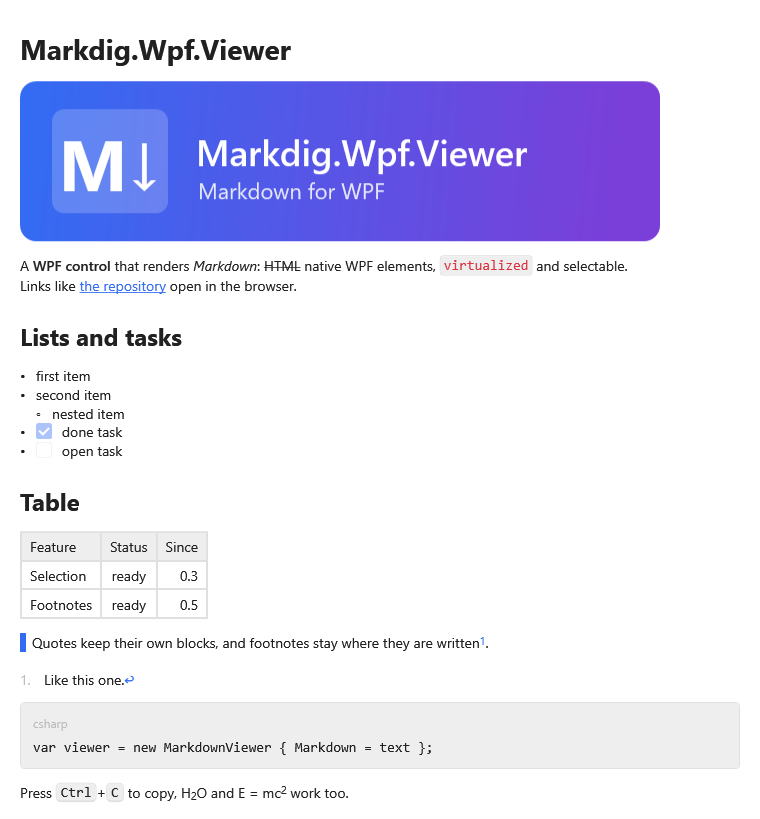

**English** | [Русский](Home-ru)

Markdig.Wpf.Viewer is a WPF control that shows Markdown as native WPF elements:
[Markdig](https://github.com/xoofx/markdig) parses the text, WPF templates draw it. No browser, no
HTML in between.



What you get:

- **One control in your own scrolling.** The viewer creates only the blocks you can see, so a long
  document, a page with other content around it or a chat list of messages stays fast.
- **Text like in a document.** Selection runs across paragraphs, lists and tables; copying puts plain
  text, Markdown and HTML on the clipboard at once.
- **Navigation.** Links open in the browser, anchors and footnotes scroll inside the document, headings
  give a table of contents, and your application can take over any link.
- **Your look.** Every color, font and margin is a resource key; any block can get your own template.
- **Your syntax.** Extensions turn your own Markdown constructs into your own widgets.
- **Source lines.** The viewer maps source lines to screen positions and back: line numbers, sync with
  an editor, two panes side by side.

## Documentation

**Basics**

- [Getting Started](Getting-Started) — install, connect the theme, show the first document
- [Supported Markdown](Supported-Markdown) — what is drawn and how
- [Scrolling and Virtualization](Scrolling-and-Virtualization) — where to put the viewer

**Working with Text**

- [Selection](Selection) — mouse, keyboard, selection from code, positions on screen
- [Copying](Copying) — clipboard formats, your own copy logic, context menu
- [Links and Anchors](Links-and-Anchors) — anchors, table of contents, scrolling to a place
- [Accessibility](Accessibility) — screen readers and keyboard

**Appearance**

- [Theming](Theming) — theme keys, dark theme, interface strings
- [Styles and Templates](Styles-and-Templates) — inline styles, block styles and templates
- [Code Blocks](Code-Blocks) — header, copy button, line numbers inside code
- [Line Numbers](Line-Numbers) — source line numbers in the margin

**Extensibility and Integration**

- [Extensions](Extensions) — your own syntax, widgets and their state, overriding built-in syntax
- [Images](Images) — sizes, sources, your own loader
- [Task Lists](Task-Lists) — check boxes your application toggles
- [Application Links](Application-Links) — links into your application, your own link opener
- [Source Lines and Two Panes](Source-Lines-and-Two-Panes) — sync with an editor, side-by-side diff
- [Live Preview](Live-Preview) — text that changes while you look at it
- [Search Highlighting](Search-Highlighting) — highlighting found text and other ranges

**Ready-made Extensions**

- [Callouts and Collapsibles](Kit-Callouts) — Obsidian callouts, MkDocs admonitions, `:::kind` containers
- [Links and References](Kit-Links) — wiki links, tags, mentions, issue links, a table of contents in place
- [Chips and Text Review](Kit-Text) — chips, color codes, CriticMarkup, comments, spoilers, task statuses
- [Media and Data](Kit-Media) — video cards, emoji, shortcodes, tables from CSV, a properties card

## Showcase

The repository has a showcase application with the scenarios from this wiki: a full document with a
table of contents, a custom look, extensions, copying, live preview, two panes and a large document.
Run it from the repository root:

```bash
dotnet run --project Markdig.Wpf.Viewer.Showcase
```
