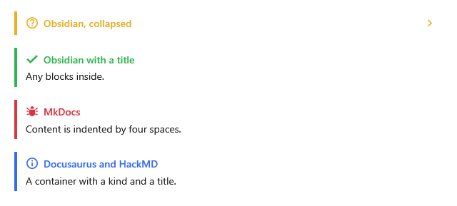

[English](Kit-Callouts) | **Русский**

Готовые расширения для плашек и сворачиваемых блоков в синтаксисе Obsidian, MkDocs, Docusaurus,
VuePress и HackMD. Они поставляются с пакетом, по умолчанию выключены и подключаются каждое одной
строкой.



## Подключение

Готовые расширения лежат в пространстве имён `MarkdigWpfViewer.Kit`.

**`MainWindow.xaml`** (`xmlns:kit="clr-namespace:MarkdigWpfViewer.Kit;assembly=Markdig.Wpf.Viewer"` на
корневом элементе):

```xml
<mdv:MarkdownViewer Markdown="{Binding Text}">
    <mdv:MarkdownViewer.Extensions>
        <kit:ObsidianCallouts />
        <kit:MkDocsAdmonitions />
        <kit:CalloutContainers />
    </mdv:MarkdownViewer.Extensions>
</mdv:MarkdownViewer>
```

**`MainWindow.xaml.cs`**, в конструкторе (`using MarkdigWpfViewer.Kit;`):

```csharp
Viewer.Extensions.Add(new ObsidianCallouts());
```

## Виды

Все три рисуют одни и те же [плашки](Supported-Markdown-ru#плашки). Кроме пяти видов GitHub есть ещё
десять, у каждого свои цвет, значок и заголовок — ключи темы `Md.Callout.<Вид>.Brush`, `.Icon` и
`.Title`, см. [Тема → Виды плашек](Theming-ru#виды-плашек). Регистр букв не важен. Другое имя вида
получает вид того, чьё оно, а заголовком остаётся само.

| Вид | Другие имена |
|---|---|
| `note` | — |
| `tip` | `hint` |
| `important` | — |
| `warning` | `attention` |
| `caution` | — |
| `abstract` | `summary`, `tldr` |
| `info` | — |
| `todo` | — |
| `success` | `check`, `done` |
| `question` | `help`, `faq` |
| `failure` | `fail`, `missing` |
| `danger` | `error` |
| `bug` | — |
| `example` | — |
| `quote` | `cite` |

Любой другой вид рисуется заметкой со своим названием в заголовке. В Obsidian `important` и
`caution` — другие имена `tip` и `warning`; здесь они сохраняют вид GitHub.

## Плашки Obsidian

`ObsidianCallouts` добавляет к синтаксису GitHub то, что добавляет Obsidian: заголовок после вида и
`-` или `+` сразу после вида — плашка сворачивается; с `-` она сначала свёрнута. Плашки вкладываются.

**Любой `.md`-файл**:

```markdown
> [!faq]- Why is the sky blue?
> Because of Rayleigh scattering.

> [!example] Nested
> > [!quote]
> > A callout inside a callout.
```

## Предупреждения MkDocs

`MkDocsAdmonitions` читает `!!! вид "Заголовок"` с содержимым под отступом в четыре пробела; `???`
начинает свёрнутое сворачиваемое предупреждение, `???+` — развёрнутое. Заголовок — простой текст; без
него показывается заголовок вида.

**Любой `.md`-файл**:

```markdown
!!! warning "Breaking change"
    `Render` is gone, use `Draw`.

??? tip "More"
    Hidden until expanded.
```

## Контейнеры `:::вид`

`CalloutContainers` читает контейнеры Docusaurus, VuePress и HackMD: известный вид становится
плашкой, `details` и `spoiler` — сворачиваемым блоком. Заголовок идёт после имени или в квадратных
скобках, как в Docusaurus 3; `{state="open"}` сразу разворачивает спойлер HackMD. Контейнер с любым
другим именем показывает содержимое, как без расширения.

**Любой `.md`-файл**:

```markdown
:::tip Pro tip
Callouts cost nothing.
:::

:::details Click to expand
Hidden text.
:::
```

## Копирование как Markdown

Плашки всех трёх расширений копируются синтаксисом Obsidian — `> [!ВИД]` со знаком сворачивания и
заголовком; сворачиваемые блоки — тегами `<details>` и `<summary>`.
