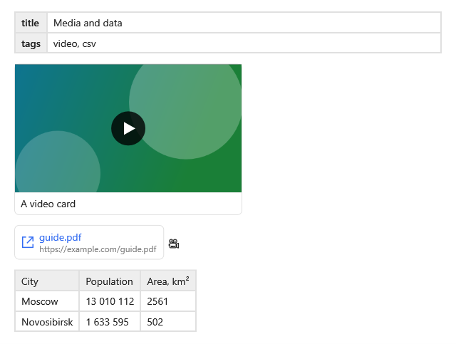

**English** | [Русский](Kit-Media-ru)

Ready-made extensions for media and data: video cards, emoji shortcodes, Hugo and Jekyll shortcodes,
tables from CSV and a properties card for front matter. Off by default, connected one line each
(`xmlns:kit="clr-namespace:MarkdigWpfViewer.Kit;assembly=Markdig.Wpf.Viewer"`), like the
[callouts](Kit-Callouts#connecting).



**`MainWindow.xaml`**:

```xml
<mdv:MarkdownViewer Markdown="{Binding Text}">
    <mdv:MarkdownViewer.Extensions>
        <kit:VideoCards />
        <kit:EmojiShortcodes />
        <kit:Shortcodes />
        <kit:CsvTables />
        <kit:PropertiesCard />
    </mdv:MarkdownViewer.Extensions>
</mdv:MarkdownViewer>
```

## Video cards

`VideoCards`: an image link to a video on YouTube, Vimeo or RuTube — the way READMEs show videos — is a
card: a preview, the title from the alt text and a play icon. An image whose address is a video is a
card too: YouTube gives a preview by the address of the video, Vimeo and RuTube do not, and their card
has no preview. A click goes the way of [links](Application-Links): the `Navigate` event, then the link
opener.

**Any `.md` file**:

```markdown
[](https://www.youtube.com/watch?v=VIDEO_ID)


```

The preview is loaded by the [image loader](Images#your-own-loader) of the viewer.
`LoadThumbnails="False"` keeps cards off the network: a preview from the internet is not loaded, a
local one still is.

```xml
<kit:VideoCards LoadThumbnails="False" />
```

## Emoji shortcodes

`EmojiShortcodes`: GitHub emoji names — `:smile:`, `:rocket:`, `:white_check_mark:` — become emoji.
Smileys like `:)` stay text.

WPF draws emoji in one color: it has no color fonts, so an emoji takes the color of the text around
it.

## Shortcodes

`Shortcodes`: `` and `{}` of Hugo and ``
of Jekyll are widgets by name. Arguments are divided by spaces, an argument with spaces is quoted,
`key=value` is a named argument. A shortcode nobody handles stays text.

| Name | Arguments | Becomes |
|---|---|---|
| `youtube` | the video id, a title | a video card |
| `vimeo` | the video id, a title | a video card without a preview |
| `gist` | `user/id` or `user id` | a link card to the gist |
| `pdf` | the address | a link card with the file name |
| `toc` | — | the [table of contents](Kit-Links#table-of-contents) in place, when the shortcode is a paragraph of its own |

**Any `.md` file**:

```markdown





```

Video cards from shortcodes obey `LoadThumbnails` of `Shortcodes`, the same as in `VideoCards`.

The application adds its own names to `Handlers`. A handler gets the shortcode — the name, the
arguments, the named arguments — and returns the model of a widget: an inline widget goes into the
line, a block widget replaces a paragraph that is this shortcode alone. `null` leaves the shortcode as
text.

**`MainWindow.xaml.cs`**, in the window constructor after `InitializeComponent()`
(`using MarkdigWpfViewer.Kit;`, `using MarkdigWpfViewer.ViewModels;`):

```csharp
var shortcodes = new Shortcodes();
shortcodes.Handlers["kbd"] = shortcode => new RunVm(string.Join(" ", shortcode.Arguments), Kbd: true);
Viewer.Extensions.Add(shortcodes);
```

Now `` is a key. `Argument(name, index)` returns a named argument or, without
it, the argument at that position. A widget with its own model and template is made as in
[Extensions](Extensions).

## Tables from CSV

`CsvTables`: a code block in `csv` or `tsv` is a table, the first row is the header. Values follow the
CSV rules: a value in quotes keeps commas and line breaks, `""` inside it is a quote; spaces around a
value without quotes are dropped. Short rows get empty cells up to the widest one.

**Any `.md` file**:

````markdown
```csv
City,Population,"Area, km²"
Moscow,13 010 112,2561
Novosibirsk,1 633 595,502
```
````

It is the usual table of the theme: selected by cells and copied as Markdown as a table.

## Properties card

`PropertiesCard`: the [front matter](Supported-Markdown#front-matter) at the start of the document is a
«key — value» table. Values are parsed only to be shown: `key: value` with or without quotes; lists
`[a, b]` and `- a` lines become one line with commas; `|` and `>` text keeps its lines; anything nested
is shown as text. The parsed data is not given out: the text of the block is still in `FrontMatter`,
and parsing YAML is up to the application.

**Any `.md` file**:

```markdown
---
title: Release notes
tags: [release, wpf]
author:
  name: Ivan
---
```

Copied as Markdown whole, the card gives back the front matter as it is written.

## Look

| Key | What it is |
|---|---|
| `Md.VideoCard.Template` | the template of a video card; `Md.VideoCard.Width`, `.PreviewHeight`, `.CornerRadius`, `.TitlePadding`, `.PreviewBackground`, `.PlayBackground`, `.PlayForeground`, `.PlayIcon` |
| `Md.VideoCard.PreviewStyle` | `MdImage` style of the preview |
| `Md.LinkCard.Template` | the template of a link card; `Md.LinkCard.Padding`, `.CornerRadius`, `.AddressForeground`, `.AddressFontSize`, `.Icon` |
| `Md.Properties.Template` | the template of the properties card; `Md.Properties.KeyStyle` is the `MdTextBlock` style of a key |

The borders of the cards are `Md.Table.BorderBrush`, the key column of the properties card is
`Md.Table.HeaderBackground`.
