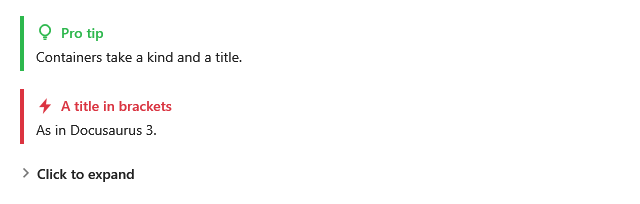

[English](Kit-Set-Docusaurus) | **Русский**

`DocusaurusSet` рисует контейнеры `:::вид` из Docusaurus и VuePress: плашки и сворачиваемые блоки.
Компоненты MDX и JSX не рисуются: они показываются текстом.



## Подключение

**`MainWindow.xaml`** (`xmlns:kit="clr-namespace:MarkdigWpfViewer.Kit;assembly=Markdig.Wpf.Viewer"` на
корневом элементе):

```xml
<mdv:MarkdownViewer Markdown="{Binding Text}">
    <mdv:MarkdownViewer.Extensions>
        <kit:DocusaurusSet />
    </mdv:MarkdownViewer.Extensions>
</mdv:MarkdownViewer>
```

## Синтаксис

| Markdown | На экране |
|---|---|
| `:::tip Заголовок` … `:::` | плашка своего вида; контейнер с незнакомым именем показывает своё содержимое |
| `:::danger[Заголовок]` … `:::` | плашка с заголовком в духе Docusaurus 3 |
| `:::details Заголовок` … `:::` | сворачиваемый блок, как в VuePress |

Виды и их другие имена — в [Плашках и сворачиваемом](Kit-Callouts-ru#виды).

**Любой `.md`-файл**:

```markdown
:::tip Pro tip
Containers take a kind and a title.
:::

:::danger[A title in brackets]
As in Docusaurus 3.
:::

:::details Click to expand
A collapsible block from VuePress.
:::
```
