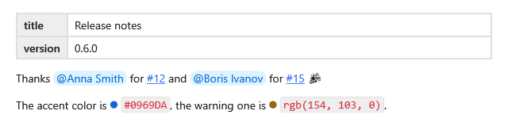

[English](Kit-Set-GitHub) | **Русский**

`GitHubSet` рисует то, что GitHub добавляет к Markdown: front matter таблицей, упоминания, ссылки на
задачи, коды цветов и эмодзи. Таблицам, спискам задач, плашкам `> [!NOTE]`, сноскам и HTML из README
набор не нужен — их вьюер рисует сам, см. [Что рисуется](Supported-Markdown-ru).



## Подключение

**`MainWindow.xaml`** (`xmlns:kit="clr-namespace:MarkdigWpfViewer.Kit;assembly=Markdig.Wpf.Viewer"` на
корневом элементе):

```xml
<mdv:MarkdownViewer Markdown="{Binding Text}">
    <mdv:MarkdownViewer.Extensions>
        <kit:GitHubSet />
    </mdv:MarkdownViewer.Extensions>
</mdv:MarkdownViewer>
```

`Resolver` даёт имена людей, `IssueTemplates` — адреса задач; без шаблона `#123` остаётся текстом. Как
их задать — в [Наборах](Kit-Sets-ru#настройки).

## Синтаксис

| Markdown | На экране | Часть |
|---|---|---|
| `---` … `---` в начале | таблица «ключ — значение» | [карточка свойств](Kit-Media-ru#карточка-свойств) |
| `@имя` | чип с именем человека | [упоминания](Kit-Links-ru#упоминания) |
| `#123`, `org/repo#45` | ссылка по твоему шаблону | [ссылки на задачи](Kit-Links-ru#ссылки-на-задачи) |
| `` `#0969DA` ``, `` `rgb(9, 105, 218)` `` | код с кружком своего цвета | [коды цветов](Kit-Text-ru#коды-цветов) |
| `:tada:` | эмодзи | [эмодзи](Kit-Media-ru#эмодзи-шорткоды) |

**Любой `.md`-файл**:

```markdown
---
title: Release notes
version: 0.6.0
---

Thanks @anna for #12 and @boris for #15 :tada:

The accent color is `#0969DA`, the warning one is `rgb(154, 103, 0)`.
```
