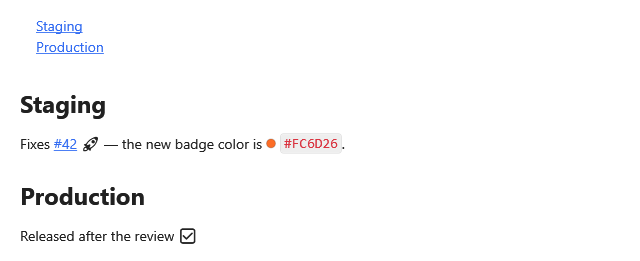

**English** | [Русский](Kit-Set-GitLab-ru)

`GitLabSet` draws what GitLab adds to Markdown: a table of contents in place, issue links, color codes
and emoji. Merge requests `!123` stay text: issue links know only the prefixes `#`, `group/project#`
and `PROJ-`.



## Connecting

**`MainWindow.xaml`** (`xmlns:kit="clr-namespace:MarkdigWpfViewer.Kit;assembly=Markdig.Wpf.Viewer"` and
`xmlns:sys="clr-namespace:System;assembly=System.Runtime"` on the root element):

```xml
<mdv:MarkdownViewer Markdown="{Binding Text}">
    <mdv:MarkdownViewer.Extensions>
        <kit:GitLabSet>
            <kit:GitLabSet.IssueTemplates>
                <sys:String x:Key="#">https://gitlab.com/group/project/-/issues/{0}</sys:String>
            </kit:GitLabSet.IssueTemplates>
        </kit:GitLabSet>
    </mdv:MarkdownViewer.Extensions>
</mdv:MarkdownViewer>
```

Without a template `#123` stays text.

## Syntax

| Markdown | On the screen | Part |
|---|---|---|
| `[[_TOC_]]`, `[TOC]` as a paragraph | the headings of the document | [table of contents](Kit-Links#table-of-contents) |
| `#123` | a link by your template | [issue links](Kit-Links#issue-links) |
| `` `#FC6D26` ``, `` `hsl(15, 97%, 57%)` `` | the code with a circle of its color | [color codes](Kit-Text#color-codes) |
| `:rocket:` | an emoji | [emoji](Kit-Media#emoji-shortcodes) |

**Any `.md` file**:

```markdown
[[_TOC_]]

## Staging

Fixes #42 :rocket: — the new badge color is `#FC6D26`.

## Production

Released after the review :white_check_mark:
```
