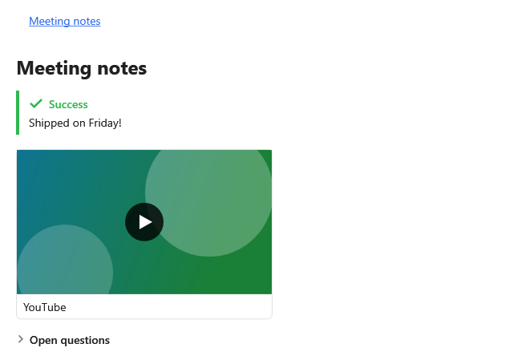

[English](Kit-Set-HackMD) | **Русский**

`HackMDSet` рисует заметки HackMD и CodiMD: контейнеры `:::вид`, оглавление и встраивания
``, ``, ``, ``.



## Подключение

**`MainWindow.xaml`** (`xmlns:kit="clr-namespace:MarkdigWpfViewer.Kit;assembly=Markdig.Wpf.Viewer"` на
корневом элементе):

```xml
<mdv:MarkdownViewer Markdown="{Binding Text}">
    <mdv:MarkdownViewer.Extensions>
        <kit:HackMDSet />
    </mdv:MarkdownViewer.Extensions>
</mdv:MarkdownViewer>
```

`LoadThumbnails="False"` не пускает превью видео в сеть. Другие встраивания HackMD — ``,
`` — остаются текстом, пока приложение не добавит их в `ShortcodeHandlers`, как в
[шорткодах](Kit-Media-ru#шорткоды).

## Синтаксис

| Markdown | На экране | Часть |
|---|---|---|
| `:::success`, `:::info`, `:::warning`, `:::danger` … `:::` | плашка своего вида | [контейнеры `:::вид`](Kit-Callouts-ru#контейнеры-вид) |
| `:::spoiler Заголовок` … `:::` | сворачиваемый блок; `{state="open"}` после имени раскрывает его | [контейнеры `:::вид`](Kit-Callouts-ru#контейнеры-вид) |
| `[TOC]` отдельным абзацем | заголовки документа | [оглавление](Kit-Links-ru#оглавление) |
| ``, `` | карточка видео | [шорткоды](Kit-Media-ru#шорткоды) |
| ``, `` | карточка-ссылка | [шорткоды](Kit-Media-ru#шорткоды) |

**Любой `.md`-файл**:

```markdown
[TOC]

## Meeting notes

:::success
Shipped on Friday!
:::



:::spoiler Open questions
Hidden until expanded.
:::
```
