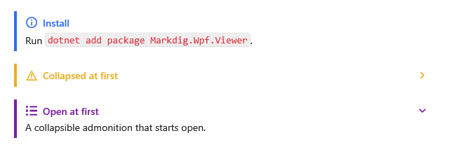

[English](Kit-Set-MkDocs) | **Русский**

`MkDocsSet` рисует предупреждения MkDocs и Material for MkDocs: `!!!` — плашка, `???` — сворачиваемая
плашка. Таблицам, сноскам, сокращениям, спискам определений и спискам задач набор не нужен.



## Подключение

**`MainWindow.xaml`** (`xmlns:kit="clr-namespace:MarkdigWpfViewer.Kit;assembly=Markdig.Wpf.Viewer"` на
корневом элементе):

```xml
<mdv:MarkdownViewer Markdown="{Binding Text}">
    <mdv:MarkdownViewer.Extensions>
        <kit:MkDocsSet />
    </mdv:MarkdownViewer.Extensions>
</mdv:MarkdownViewer>
```

## Синтаксис

| Markdown | На экране |
|---|---|
| `!!! note "Заголовок"` и содержимое под отступом в четыре пробела | плашка; без заголовка — заголовок вида |
| `??? warning "Заголовок"` | сворачиваемая плашка, свёрнута |
| `???+ example "Заголовок"` | сворачиваемая плашка, развёрнута |

Виды и их другие имена — в [Плашках и сворачиваемом](Kit-Callouts-ru#виды).

**Любой `.md`-файл**:

```markdown
!!! note "Install"
    Run `dotnet add package Markdig.Wpf.Viewer`.

??? warning "Collapsed at first"
    Click the title to read.

???+ example "Open at first"
    A collapsible admonition that starts open.
```
