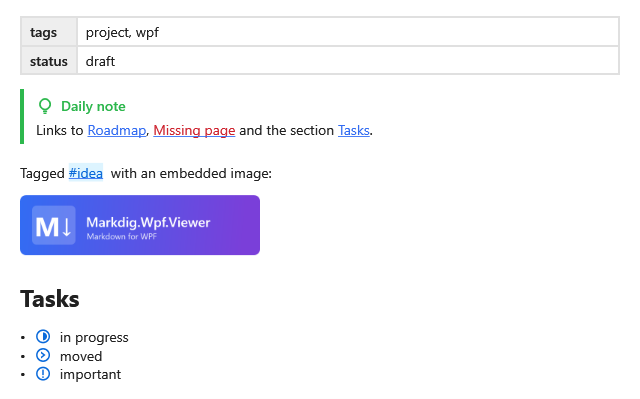

**English** | [Русский](Kit-Set-Obsidian-ru)

`ObsidianSet` draws the notes of Obsidian: properties, callouts, comments, embedded images, wiki
links, tags and task statuses. `==highlight==` and footnotes need no set. Math and diagrams are not in
the set: they are a job for [your extensions](Extensions).



## Connecting

**`MainWindow.xaml`** (`xmlns:kit="clr-namespace:MarkdigWpfViewer.Kit;assembly=Markdig.Wpf.Viewer"` on
the root element):

```xml
<mdv:MarkdownViewer Markdown="{Binding Text}">
    <mdv:MarkdownViewer.Extensions>
        <kit:ObsidianSet />
    </mdv:MarkdownViewer.Extensions>
</mdv:MarkdownViewer>
```

`Resolver` tells which pages exist: a link to a missing page gets its own color. A click on a wiki link
or a tag goes to your application as `wiki:Page#Section` or `tag:name` — see
[Links and References](Kit-Links).

## Syntax

| Markdown | On the screen | Part |
|---|---|---|
| `---` … `---` at the start | a «key — value» table | [properties card](Kit-Media#properties-card) |
| `> [!tip] Title`, `> [!faq]-`, `> [!todo]+` | a callout of the kind; `-` and `+` make it collapsible | [Obsidian callouts](Kit-Callouts#obsidian-callouts) |
| `%%comment%%`, a block between `%%` lines | nothing | [comments](Kit-Text#comments) |
| `![[picture.png]]`, `![[picture.png\|200]]` | an image; an embed of anything else is a wiki link | [embedded images](Kit-Links#embedded-images) |
| `[[Page]]`, `[[Page#Section]]`, `[[Page\|label]]`, `[[#Heading]]` | a link | [wiki links](Kit-Links#wiki-links) |
| `#tag`, `#nested/tag` | a tag | [tags](Kit-Links#tags) |
| `- [/]`, `- [-]`, `- [>]`, `- [?]`, `- [!]` | an icon of the status | [task statuses](Kit-Text#task-statuses) |

**Any `.md` file**:

```markdown
---
tags: [project, wpf]
status: draft
---

> [!tip] Daily note
> Links to [[Roadmap]], [[Missing page]] and the section [[#Tasks]].

Tagged #idea %%a hidden comment%% with an embedded image:

![[banner.png|240]]

## Tasks

- [/] in progress
- [>] moved
- [!] important
```
