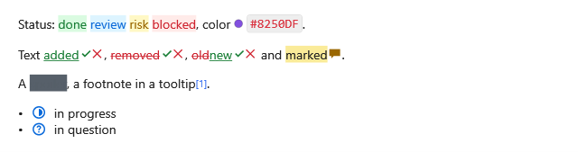

[English](Kit-Text) | **Русский**

Готовые расширения для вида и вычитки текста: чипы, коды цветов, CriticMarkup, скрытые комментарии,
спойлеры, статусы задач и сноски подсказкой. По умолчанию выключены и подключаются каждое одной строкой
(`xmlns:kit="clr-namespace:MarkdigWpfViewer.Kit;assembly=Markdig.Wpf.Viewer"`), как
[плашки](Kit-Callouts-ru#подключение).



**`MainWindow.xaml`**:

```xml
<mdv:MarkdownViewer Markdown="{Binding Text}">
    <mdv:MarkdownViewer.Extensions>
        <kit:Chips />
        <kit:ColorChips />
        <kit:CriticMarkup />
        <kit:Comments />
        <kit:Spoilers />
        <kit:TaskStatuses />
        <kit:FootnoteTips />
    </mdv:MarkdownViewer.Extensions>
</mdv:MarkdownViewer>
```

## Чипы

`Chips`: `::текст::` — чип, `::текст::{.вид}` — чип вида `info`, `success`, `warning` или `danger`;
любой другой вид — обычный чип. Чип — оформленный текст: выделяется по буквам, находится поиском.

**Любой `.md`-файл**:

```markdown
Status: ::done::{.success}, ::blocked::{.danger}, ::draft::.
```

## Коды цветов

`ColorChips`: код в строке, который целиком — цвет (`#RGB`, `#RRGGBB`, `#RRGGBBAA`, `rgb()`, `rgba()`,
`hsl()`, `hsla()`), получает рядом кружок этого цвета.

**Любой `.md`-файл**:

```markdown
The accent is `#0969DA`, the hover is `rgba(9, 105, 218, 0.8)`.
```

## CriticMarkup

`CriticMarkup` рисует правки оформленным текстом: `{++вставка++}`, `{--удаление--}`,
`{~~было~>стало~~}`, `{==выделение==}`; `{>>комментарий<<}` — значок с комментарием в подсказке.

С `AllowDecisions="True"` у каждой вставки, удаления и замены появляются кнопки «принять» и
«отклонить». Сам вьюер текст не меняет: щелчок поднимает всплывающее событие `CriticMarkup.Decided` с
местом правки в исходнике, `Change`, и текстом, который встаёт на её место, `Replacement`. Текст правит
приложение, как со [списками задач](Task-Lists-ru).

**`MainWindow.xaml`**:

```xml
<mdv:MarkdownViewer x:Name="Viewer" kit:CriticMarkup.Decided="OnDecided">
    <mdv:MarkdownViewer.Extensions>
        <kit:CriticMarkup AllowDecisions="True" />
    </mdv:MarkdownViewer.Extensions>
</mdv:MarkdownViewer>
```

**`MainWindow.xaml.cs`**, в классе окна (`using MarkdigWpfViewer.Kit;`):

```csharp
private void OnDecided(object sender, MdCriticDecidedEventArgs e)
{
    var text = Viewer.Markdown;
    Viewer.Markdown = text[..e.Change.Start] + e.Replacement + text[e.Change.End..];
}
```

## Комментарии

`Comments`: `%%комментарий%%` внутри строки и блок между строками `%%` не рисуются.

**Любой `.md`-файл**:

```markdown
Visible text %%and a hidden note%%.

%%
A hidden block
of several lines.
%%
```

## Спойлеры

`Spoilers`: `||текст||` закрашен, пока по нему не щёлкнут; щелчок открывает его и закрывает снова, а
открытый спойлер остаётся открытым, пока меняется текст. В строке таблицы `|` делит ячейки, поэтому
спойлера там нет.

## Статусы задач

`TaskStatuses`: `- [/]` в работе, `- [-]` отменена, `- [>]` перенесена, `- [?]` под вопросом, `- [!]`
важная — значок вместо флажка. Щелчок поднимает тот же `TaskToggled`, что у
[задачи](Task-Lists-ru#переключение-задач), с `IsChecked = true`; `Task.Status` — знак статуса.

## Сноски подсказкой

`FootnoteTips`: ссылка на сноску показывает сноску во всплывающей подсказке, а определение не рисуется
там, где написано.

## Вид

| Ключ | Что это |
|---|---|
| `Md.Chip.Style`, `Md.Chip.Info.Style`, `Md.Chip.Success.Style`, `Md.Chip.Warning.Style`, `Md.Chip.Danger.Style` | стили `Span` чипов |
| `Md.ColorCode.Template` | шаблон кода цвета; `Md.ColorCode.SwatchSize`, `.SwatchMargin`, `.SwatchBorder` |
| `Md.Critic.Insertion.Style`, `Md.Critic.Deletion.Style`, `Md.Critic.Highlight.Style` | стили `Span` правок |
| `Md.Critic.Comment.Template`, `Md.Critic.Decision.Template` | значок комментария и кнопки решения; `Md.Critic.CommentIcon`, `.CommentForeground`, `.AcceptIcon`, `.RejectIcon`, `.AcceptForeground`, `.RejectForeground` |
| `Md.Critic.AcceptToolTip`, `Md.Critic.RejectToolTip` | подписи кнопок |
| `Md.Spoiler.Style` | стиль `Span` спойлера; `Md.Spoiler.Cover`, `Md.Spoiler.RevealedBackground` |
| `Md.TaskStatus.Template`, `Md.TaskStatus.Style` | задача со статусом; `Md.TaskStatus.Foreground`, `Md.TaskStatus.InProgress.Icon`, `.Cancelled.Icon`, `.Forwarded.Icon`, `.Question.Icon`, `.Important.Icon` |
| `Md.FootnoteTip.Template` | ссылка на сноску с подсказкой; `Md.FootnoteTip.MaxWidth` |

«Копировать как Markdown» пишет чипы, правки, спойлеры и статусы задач обратно их синтаксисом.
