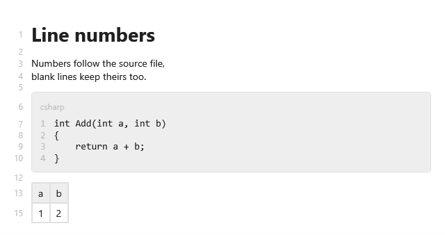

[English](Line-Numbers) | **Русский**

`ShowSourceLineNumbers` показывает номера строк исходника на полях слева, как в редакторе. Номера
идут с 1.



**Окно или пользовательский контрол**:

```xml
<ScrollViewer>
    <mdv:MarkdownViewer Markdown="{Binding Text}"
                        ShowSourceLineNumbers="True"
                        ShowCodeLineNumbers="True"
                        Margin="8,16,24,16" />
</ScrollViewer>
```

## Какие строки получают номер

Номер стоит у каждой строки исходника, у которой есть своё место на экране: строки текста, пустые
строки, шапка блока кода и его строки кода. Закрывающее ограждение блока кода, строка-разделитель
таблицы и `===` или `---` под заголовком своего места не имеют и номера не получают. Ширина полей одна
на весь документ, поэтому при прокрутке они не прыгают.

`ShowCodeLineNumbers` — другая нумерация: с 1 внутри каждого блока кода, см.
[Блоки кода](Code-Blocks-ru#номера-строк-в-коде).

## Вид

Поля берут ключи `Md.Gutter.FontFamily`, `Md.Gutter.Foreground`, `Md.Gutter.FontSize` и
`Md.Gutter.Padding` — см. [Тему](Theming-ru). Свой шаблон вьюера сохраняет поля, если в нём есть
`p:MdLineGutter x:Name="PART_Gutter"`.

## Номера и исходник

Номера — это номера строк текста из `Markdown`, те же, что показывает редактор для этого текста. Из
кода строки считаются с 0 — см. [Строки исходника и две панели](Source-Lines-and-Two-Panes-ru).
