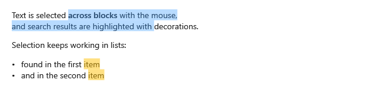

**English** | [Русский](Search-Highlighting-ru)

`Decorations` paints ranges of the text map with brushes: found text, changed lines, comments,
anything your application marks. Decorations are drawn under the text and under the selection.



## Highlighting found text

The [text map](Selection#positions-the-text-map) is the text the user sees, the whole document with
the blocks out of view, so a search is a plain `IndexOf` over `TextMap.Text`.

**`MainWindow.xaml`**:

```xml
<DockPanel>
    <TextBox x:Name="SearchBox" DockPanel.Dock="Top" TextChanged="OnSearchChanged" />
    <ScrollViewer>
        <mdv:MarkdownViewer x:Name="Viewer" Markdown="{Binding Text}" Margin="24,16" />
    </ScrollViewer>
</DockPanel>
```

**`MainWindow.xaml.cs`**, in the window class (`using System.Windows.Media; using MarkdigWpfViewer.Selection;`):

```csharp
private static readonly Brush FoundBrush = new SolidColorBrush(Color.FromArgb(0x80, 0xFF, 0xC1, 0x07));

private void OnSearchChanged(object sender, TextChangedEventArgs e)
{
    var query = SearchBox.Text;
    var text = Viewer.TextMap.Text;
    var found = new List<MdDecoration>();

    for (var index = query.Length == 0 ? -1 : text.IndexOf(query, StringComparison.OrdinalIgnoreCase);
         index >= 0;
         index = text.IndexOf(query, index + query.Length, StringComparison.OrdinalIgnoreCase))
    {
        found.Add(new MdDecoration(new MdTextRange(index, query.Length), FoundBrush));
    }

    Viewer.Decorations = found;
    if (found.Count > 0)
    {
        Viewer.ScrollToRange(found[0].Range, 0.3);
    }
}
```

To step through the results, keep the index of the current one, scroll to it with `ScrollToRange` and
give it a brush of its own.

## Other ranges

A decoration is any range of the text map with any brush. `TextMap.RangeOfSourceLines(start, end)`
turns source lines into a range — that is how [two panes](Source-Lines-and-Two-Panes) highlight
changed lines. Keep the brushes semi-transparent: the text is drawn over them.

## When the text changes

A new `Markdown` builds a new text map at once, and the old positions may point elsewhere. Compute the
decorations again right after setting a new text.
