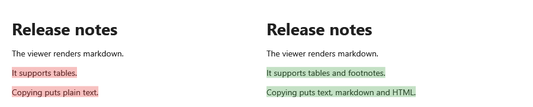

[English](Source-Lines-and-Two-Panes) | **Русский**

Каждый элемент документа знает строки исходника, из которых он взят, а вьюер переводит строки
исходника в позиции на экране и обратно. Этого хватает, чтобы держать вьюер в ногу с редактором,
подсвечивать строки или прокручивать две версии документа рядом.



## Строки из кода

Строки считаются с 0, в отличие от [номеров строк](Line-Numbers-ru) на экране. Дробная часть — доля
строки: `12.5` — середина строки 12.

| Задача | Член |
|---|---|
| где строка | `GetSourceLineOffset(line)` — позиция в координатах вьюера |
| какая строка в позиции | `GetSourceLineAt(offset)` |
| какая строка видна | `GetVisibleSourceLine(fraction)` — строка в доле высоты прокрутки; событие `ViewportChanged` говорит, когда спросить снова |
| прокрутить к строке | `ScrollToSourceLine(line, fraction)` — строка встаёт в долю высоты прокрутки |
| кусок текстовой карты по строкам | `TextMap.RangeOfSourceLines(start, end)` — для [подсветки](Search-Highlighting-ru) или выделения |
| строка позиции текстовой карты | `TextMap.SourceLineOf(position)` |

Прокрутка вокруг вьюера должна быть попиксельной: `ScrollViewer` такой и есть, списку нужен
`VirtualizingPanel.ScrollUnit="Pixel"`.

## Вслед за редактором

Вьюер прокручивается к первой видимой строке `TextBox` каждый раз, когда прокручивается редактор.

**`MainWindow.xaml`**:

```xml
<Grid>
    <Grid.ColumnDefinitions>
        <ColumnDefinition />
        <ColumnDefinition />
    </Grid.ColumnDefinitions>

    <TextBox x:Name="Editor"
             AcceptsReturn="True"
             FontFamily="Consolas"
             VerticalScrollBarVisibility="Auto"
             HorizontalScrollBarVisibility="Auto"
             TextChanged="OnEditorChanged"
             ScrollViewer.ScrollChanged="OnEditorScrolled" />

    <ScrollViewer Grid.Column="1">
        <mdv:MarkdownViewer x:Name="Viewer" Margin="24,16" />
    </ScrollViewer>
</Grid>
```

**`MainWindow.xaml.cs`**, в классе окна:

```csharp
private void OnEditorChanged(object sender, TextChangedEventArgs e) => Viewer.Markdown = Editor.Text;

private void OnEditorScrolled(object sender, ScrollChangedEventArgs e)
{
    if (e.VerticalChange != 0)
    {
        Viewer.ScrollToSourceLine(Editor.GetFirstVisibleLineIndex());
    }
}
```

Редактор здесь не переносит строки: тогда его видимые строки — это строки исходника.

## Две панели

`MdScrollSync` прокручивает два вьюера вместе. Ведёт панель, с которой работает пользователь, вторая
догоняет её так, чтобы соответствующие строки стояли на одной высоте. Какие строки соответствуют,
говорит `MdLineMap`: опорные пары строк — например, неизменённые строки диффа, — а строки между
опорами пересчитываются линейно. Двум копиям одного текста опоры не нужны: `MdLineMap.Identity`.

**`MainWindow.xaml`**, два вьюера в двух прокрутках; окно обрабатывает `Loaded` и `Unloaded`:

```xml
<Grid>
    <Grid.ColumnDefinitions>
        <ColumnDefinition />
        <ColumnDefinition />
    </Grid.ColumnDefinitions>
    <ScrollViewer>
        <mdv:MarkdownViewer x:Name="LeftViewer" Markdown="{Binding Old}" Margin="24,16" />
    </ScrollViewer>
    <ScrollViewer Grid.Column="1">
        <mdv:MarkdownViewer x:Name="RightViewer" Markdown="{Binding New}" Margin="24,16" />
    </ScrollViewer>
</Grid>
```

**`MainWindow.xaml.cs`**, в классе окна (`using System.Windows.Media; using MarkdigWpfViewer.Scrolling;
using MarkdigWpfViewer.Selection;`):

```csharp
private static readonly Brush RemovedBrush = new SolidColorBrush(Color.FromArgb(0x50, 0xE5, 0x39, 0x35));
private static readonly Brush AddedBrush = new SolidColorBrush(Color.FromArgb(0x50, 0x43, 0xA0, 0x47));

private MdScrollSync? _sync;

private void OnLoaded(object sender, RoutedEventArgs e)
{
    var left = (LeftViewer.Markdown ?? string.Empty).Split('\n');
    var right = (RightViewer.Markdown ?? string.Empty).Split('\n');
    var matches = MatchLines(left, right);

    var anchors = matches.SelectMany(match => new[]
    {
        ((double)match.Left, (double)match.Right),
        (match.Left + 1.0, match.Right + 1.0)
    });
    _sync = new MdScrollSync(LeftViewer, RightViewer, new MdLineMap(anchors));

    LeftViewer.Decorations = Highlight(LeftViewer, left.Length, matches.Select(match => match.Left), RemovedBrush);
    RightViewer.Decorations = Highlight(RightViewer, right.Length, matches.Select(match => match.Right), AddedBrush);
}

private void OnUnloaded(object sender, RoutedEventArgs e)
{
    _sync?.Dispose();
    _sync = null;
}

private static List<(int Left, int Right)> MatchLines(string[] left, string[] right)
{
    var matches = new List<(int Left, int Right)>();
    var next = 0;
    for (var i = 0; i < left.Length; i++)
    {
        var j = Array.IndexOf(right, left[i], next);
        if (j >= 0)
        {
            matches.Add((i, j));
            next = j + 1;
        }
    }

    return matches;
}

private static List<MdDecoration> Highlight(MarkdownViewer viewer, int lineCount, IEnumerable<int> matched, Brush brush)
    => Enumerable.Range(0, lineCount)
        .Except(matched)
        .Select(line => viewer.TextMap.RangeOfSourceLines(line, line))
        .OfType<MdTextRange>()
        .Select(range => new MdDecoration(range, brush))
        .ToList();
```

Каждая совпавшая строка закреплена началом и концом, поэтому остаётся выровненной по всей своей
высоте. `MatchLines` — наивный заместитель, который ищет равные строки по порядку; настоящее
приложение берёт совпадения из своего диффа.
