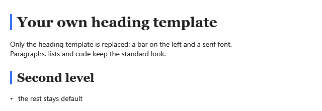

**English** | [Русский](Styles-and-Templates-ru)

The look of the viewer changes on three levels, from small to big: [theme keys](Theming) for single
values, styles for inline formatting and whole blocks, templates for blocks drawn your own way. Take
the smallest level that does the job.

## Inline formatting

Bold, italic, strikethrough and links are styled by `Span` and `Hyperlink` styles with the keys
`Md.Strong.Style`, `Md.Emphasis.Style`, `Md.Strike.Style` and `Md.Link.Style`. Marked and inserted
text, titles of works and abbreviations have `Span` styles too: `Md.Marked.Style`,
`Md.Inserted.Style`, `Md.Cite.Style`, `Md.Abbreviation.Style`.

**`App.xaml`**, the application resources:

```xml
<Style x:Key="Md.Strong.Style" TargetType="Span">
    <Setter Property="FontWeight" Value="Bold" />
    <Setter Property="Foreground" Value="#B35900" />
</Style>

<Style x:Key="Md.Link.Style" TargetType="Hyperlink">
    <Setter Property="TextDecorations" Value="{x:Null}" />
</Style>
```

## Block styles

Each block control has a style key; override it to change the control template while keeping the
rest of the theme.

| Key | Target type | What it draws |
|---|---|---|
| `Md.Paragraph.Style` | `p:MdTextBlock` | paragraphs and table cells |
| `Md.Heading.Style` | `p:MdHeadingBlock` | headings, with triggers per `Level` |
| `Md.CodeBlock.Style` | `p:CodeBlockPresenter` | code blocks |
| `Md.CodeBlock.HeaderStyle` | `TextBlock` | the language header of a code block |
| `Md.CodeBlock.CopyButtonStyle` | `Button` | the copy button of a code block |
| `Md.Quote.Style` | `p:QuotePresenter` | quotes |
| `Md.List.Style` | `ItemsControl` | lists |
| `Md.List.MarkerStyle` | `TextBlock` | list markers |
| `Md.Table.Style` | `p:MdTablePresenter` | tables |
| `Md.Paragraph.InlineCodeStyle`, `Md.Heading1.InlineCodeStyle` … `Md.Heading6.InlineCodeStyle` | `p:InlineCodePresenter` | inline code in paragraphs and headings |
| `Md.Kbd.Style` | `p:InlineCodePresenter` | keys, `<kbd>` |
| `Md.Image.Style` | `p:MdImage` | images |
| `Md.FootnoteLink.Style` | `p:MdFootnoteLink` | footnote references and `↩` |
| `Md.Footnote.MarkerStyle` | `TextBlock` | the number of a footnote definition |
| `Md.Figure.CaptionStyle` | `p:MdTextBlock` | figure captions |
| `Md.Callout.Style` | `p:MdCalloutPresenter` | callouts |
| `Md.Callout.HeaderStyle` | `ToggleButton` | the title row of a callout; a click on it folds a foldable callout |
| `Md.Callout.TitleStyle`, `Md.Callout.DefaultTitleStyle` | `p:MdTextBlock`, `TextBlock` | the own title of a callout and the title of its kind |
| `Md.Details.Style` | `p:MdDetailsPresenter` | collapsible blocks |
| `Md.Details.HeaderStyle` | `ToggleButton` | the title row of a collapsible block |
| `Md.Details.SummaryStyle`, `Md.Details.DefaultSummaryStyle` | `p:MdTextBlock`, `TextBlock` | the own title of a collapsible block and `Md.Details.Title` |
| `Md.DefinitionList.Style` | `ItemsControl` | definition lists |
| `Md.DefinitionList.TermStyle` | `p:MdTextBlock` | terms of a definition list |

A callout title in the color of the text instead of the color of its kind:

**`App.xaml`**, the application resources:

```xml
<Style x:Key="Md.Callout.DefaultTitleStyle" TargetType="TextBlock" BasedOn="{StaticResource Md.Callout.DefaultTitleStyle}">
    <Setter Property="Foreground" Value="{DynamicResource Md.Paragraph.Foreground}" />
</Style>
```

A quote on a tinted background instead of a bar on the left:

**`App.xaml`**, the application resources:

```xml
<Style x:Key="Md.Quote.Style" TargetType="p:QuotePresenter">
    <Setter Property="Template">
        <Setter.Value>
            <ControlTemplate TargetType="p:QuotePresenter">
                <Border Background="#FFF8E1" CornerRadius="4" Padding="12,8" Margin="0,0,0,4">
                    <p:MdBlocksPresenter Blocks="{TemplateBinding Blocks}" />
                </Border>
            </ControlTemplate>
        </Setter.Value>
    </Setter>
</Style>
```

## Block templates

A template replaces the way a kind of block is drawn. `MdStyleProvider` holds the templates; with
`BasedOn` pointing at the default provider you set only the templates you replace, the rest stay
standard.



**`App.xaml`**, the application resources:

```xml
<s:MdStyleProvider x:Key="MyStyleProvider" BasedOn="{StaticResource Md.DefaultStyleProvider}">
    <s:MdStyleProvider.HeadingTemplate>
        <DataTemplate DataType="{x:Type vm:HeadingVm}">
            <Border Margin="0,12,0,4" Padding="10,0,0,0" BorderThickness="4,0,0,0" BorderBrush="#326CF3">
                <p:MdHeadingBlock Level="{Binding Level}"
                                  Runs="{Binding Inlines}"
                                  Style="{DynamicResource Md.Heading.Style}"
                                  FontFamily="Georgia"
                                  Margin="0" />
            </Border>
        </DataTemplate>
    </s:MdStyleProvider.HeadingTemplate>
</s:MdStyleProvider>
```

**A window or a user control**:

```xml
<mdv:MarkdownViewer Markdown="{Binding Text}" StyleProvider="{StaticResource MyStyleProvider}" />
```

For every viewer of a window, set the provider with a style based on the viewer's own one.

**`MainWindow.xaml`**, the window resources:

```xml
<Style TargetType="mdv:MarkdownViewer" BasedOn="{StaticResource {x:Type mdv:MarkdownViewer}}">
    <Setter Property="StyleProvider" Value="{StaticResource MyStyleProvider}" />
</Style>
```

### What a template gets

The data context of a template is the model of its block — an immutable record:

| Provider property | Model | Model members |
|---|---|---|
| `ParagraphTemplate` | `vm:ParagraphVm` | `Inlines` |
| `HeadingTemplate` | `vm:HeadingVm` | `Level`, `Inlines`, `Id` |
| `CodeBlockTemplate` | `vm:CodeBlockVm` | `InfoString`, `Syntax`, `Code`, `Runs`, `IsFenced` |
| `QuoteTemplate` | `vm:QuoteVm` | `Blocks` |
| `ListTemplate` | `vm:ListVm` | `Ordered`, `Start`, `Depth`, `Items` of `vm:ListItemVm` (`MarkerText`, `Blocks`) |
| `TableTemplate` | `vm:TableVm` | `ColumnCount`, `Rows`, `Alignments`; a cell has `Inlines` or, in a grid table, `Blocks` |
| `HorizontalRuleTemplate` | `vm:ThematicBreakVm` | — |
| `BlankLineTemplate` | `vm:BlankLineVm` | — |
| `FootnoteTemplate` | `vm:FootnoteVm` | `Order`, `Label`, `Blocks` |
| `FigureTemplate` | `vm:FigureVm` | `Blocks`, the captions among them |
| `FigureCaptionTemplate` | `vm:FigureCaptionVm` | `Inlines` |
| `FooterTemplate` | `vm:FooterVm` | `Blocks` |
| `CalloutTemplate` | `vm:CalloutVm` | `Kind`, `Title`, `Blocks`, `IsFoldable`, `IsFolded` |
| `DetailsTemplate` | `vm:DetailsVm` | `Summary`, `Blocks`, `IsOpen` |
| `DefinitionListTemplate` | `vm:DefinitionListVm` | `Items` of `vm:DefinitionItemVm` (`Terms`, `HasTerms`, `Blocks`); an item without terms is one more definition of the item before it |
| `ImageTemplate` | `vm:ImageVm`, inline | `Url`, `Alt`, `Title`, `Width`, `Height`, `Href` |
| `TaskTemplate` | `vm:TaskVm`, inline | `IsChecked` |
| `FootnoteLinkTemplate` | `vm:FootnoteLinkVm`, inline | `Order`, `Index`, `IsBack`, `Target` |

The default templates are in
[`Themes/Generic.xaml`](https://github.com/porohkun/Markdig.Wpf.Viewer/blob/main/Markdig.Wpf.Viewer/Themes/Generic.xaml)
under the key `Md.DefaultStyleProvider` — copy one as a starting point.

Whether a callout or a collapsible block is folded lives in its [widget state](Extensions#widget-state),
an `MdFoldState` with `IsExpanded`: it survives scrolling and a new text. A template of your own binds
the presenter to it the way the default one does (`xmlns:mdx="clr-namespace:MarkdigWpfViewer.Extensions;assembly=Markdig.Wpf.Viewer"`):

```xml
<p:MdDetailsPresenter Summary="{Binding Summary}"
                      Blocks="{Binding Blocks}"
                      Style="{DynamicResource Md.Details.Style}"
                      IsExpanded="{Binding Path=(mdx:MdWidget.State).IsExpanded, RelativeSource={RelativeSource Self}, FallbackValue=True}" />
```

### Keep selection working

- Draw text with `p:MdTextBlock Runs="{Binding Inlines}"` (`p:MdHeadingBlock` for headings): selection,
  highlighting, links and inline widgets work inside it. A block that draws its text otherwise is
  selected as a whole.
- Draw nested blocks with `p:MdBlocksPresenter Blocks="{Binding Blocks}"`: they get the same templates
  and the same virtualization as the document.
- A template of yours with its own `ScrollViewer` passes the mouse wheel to the page with
  `b:NestedScroll.PassWheelToParent="True"` — see [Scrolling and Virtualization](Scrolling-and-Virtualization#nested-scrolling).

## The template of the viewer

If you replace the template of `MarkdownViewer` itself, keep an `ItemsPresenter` for the blocks and a
`p:MdLineGutter x:Name="PART_Gutter"` for [line numbers](Line-Numbers).
