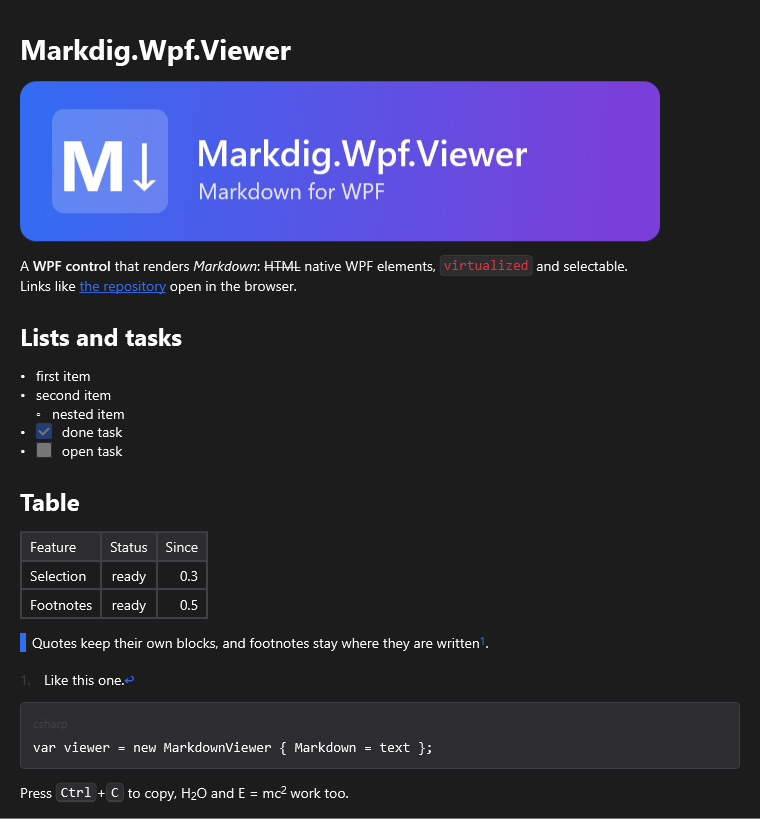

[English](Theming) | **Русский**

Каждый цвет, размер, отступ и подпись интерфейса вьюера — ключ ресурса `Md.<Блок>.<Свойство>`.
Шаблоны берут их через `DynamicResource`, поэтому ключ, перекрытый в ресурсах приложения, окна или
вьюера, действует сразу — даже на работающем приложении.



## Перекрытие ключей

Побеждает ключ, определённый ближе к вьюеру: ресурсы вьюера, затем окна, затем приложения. Внутри
одного словаря его собственные ключи побеждают влитые в него словари.

**`App.xaml`**, ресурсы приложения (`xmlns:sys="clr-namespace:System;assembly=System.Runtime"` на
корневом элементе):

```xml
<Application.Resources>
    <ResourceDictionary>
        <ResourceDictionary.MergedDictionaries>
            <ResourceDictionary Source="pack://application:,,,/Markdig.Wpf.Viewer;component/Themes/Generic.xaml" />
        </ResourceDictionary.MergedDictionaries>

        <SolidColorBrush x:Key="Md.Paragraph.LinkForeground" Color="#0969DA" />
        <SolidColorBrush x:Key="Md.CodeBlock.Background" Color="#F6F8FA" />
        <sys:Double x:Key="Md.Paragraph.FontSize">15</sys:Double>
    </ResourceDictionary>
</Application.Resources>
```

Один вьюер с текстом помельче:

```xml
<mdv:MarkdownViewer Markdown="{Binding Text}">
    <mdv:MarkdownViewer.Resources>
        <sys:Double x:Key="Md.Paragraph.FontSize">12</sys:Double>
    </mdv:MarkdownViewer.Resources>
</mdv:MarkdownViewer>
```

Ключ сохраняет тип своего значения по умолчанию: размеры — `sys:Double`, отступы — `Thickness`,
цвета — `Brush`, `Md.List.MarkerWidth` и `Md.Footnote.MarkerWidth` — `GridLength`. Значения по
умолчанию — в [`Themes/Generic.xaml`](https://github.com/porohkun/Markdig.Wpf.Viewer/blob/main/Markdig.Wpf.Viewer/Themes/Generic.xaml).

## Шрифт и цвет текста

Шрифт и цвет текста тема не задаёт: вьюер берёт их у приложения, как `TextBlock`. Ключи
`Md.Paragraph.FontFamily`, `Md.Paragraph.Foreground` и их пары для заголовков задают, только когда
текст во вьюере должен отличаться от остального приложения.

## Тёмная тема

Тёмная тема — ещё один словарь с теми же ключами: его вливают после темы вьюера и убирают, чтобы
вернуться. Ключи, определённые прямо в `Application.Resources`, побеждают любой влитый словарь,
поэтому светлые значения тоже держат в своём словаре. Цвет текста и фон дают окна приложения — их
переключают там же.

**`Themes/MarkdownDark.xaml`**, словарь ресурсов в приложении:

```xml
<ResourceDictionary xmlns="http://schemas.microsoft.com/winfx/2006/xaml/presentation"
                    xmlns:x="http://schemas.microsoft.com/winfx/2006/xaml">
    <SolidColorBrush x:Key="Md.Paragraph.LinkForeground" Color="#58A6FF" />
    <SolidColorBrush x:Key="Md.Heading.LinkForeground" Color="#58A6FF" />
    <SolidColorBrush x:Key="Md.InlineCode.Background" Color="#343942" />
    <SolidColorBrush x:Key="Md.InlineCode.Foreground" Color="#E6EDF3" />
    <SolidColorBrush x:Key="Md.InlineCode.BorderBrush" Color="#3D444D" />
    <SolidColorBrush x:Key="Md.CodeBlock.Background" Color="#161B22" />
    <SolidColorBrush x:Key="Md.CodeBlock.Foreground" Color="#E6EDF3" />
    <SolidColorBrush x:Key="Md.CodeBlock.BorderBrush" Color="#3D444D" />
    <SolidColorBrush x:Key="Md.Kbd.Background" Color="#161B22" />
    <SolidColorBrush x:Key="Md.Kbd.Foreground" Color="#E6EDF3" />
    <SolidColorBrush x:Key="Md.Kbd.BorderBrush" Color="#3D444D" />
    <SolidColorBrush x:Key="Md.Quote.BorderBrush" Color="#3D444D" />
    <SolidColorBrush x:Key="Md.Table.BorderBrush" Color="#3D444D" />
    <SolidColorBrush x:Key="Md.Table.HeaderBackground" Color="#161B22" />
</ResourceDictionary>
```

**`App.xaml.cs`**, в классе приложения:

```csharp
private ResourceDictionary? _dark;

public void SetDarkMarkdown(bool dark)
{
    if (dark && _dark is null)
    {
        _dark = new ResourceDictionary { Source = new Uri("pack://application:,,,/YourApp;component/Themes/MarkdownDark.xaml") };
        Resources.MergedDictionaries.Add(_dark);
    }
    else if (!dark && _dark is not null)
    {
        Resources.MergedDictionaries.Remove(_dark);
        _dark = null;
    }
}
```

## Подписи интерфейса

Пункты контекстного меню и имя кнопки копирования кода — тоже ключи, по умолчанию английские. Их
переводят в ресурсах приложения.

**`App.xaml`**, ресурсы приложения:

```xml
<sys:String x:Key="Md.ContextMenu.Copy">Копировать</sys:String>
<sys:String x:Key="Md.ContextMenu.CopyMarkdown">Копировать как Markdown</sys:String>
<sys:String x:Key="Md.ContextMenu.SelectAll">Выделить всё</sys:String>
<sys:String x:Key="Md.CodeBlock.CopyToolTip">Копировать код</sys:String>
```

## Все ключи

| Часть | Ключи |
|---|---|
| Абзац | `Md.Paragraph.FontFamily`\*, `Md.Paragraph.Foreground`\*, `Md.Paragraph.FontSize`, `Md.Paragraph.LinkForeground` |
| Заголовки | `Md.Heading.FontFamily`\*, `Md.Heading.Foreground`\*, `Md.Heading.LinkForeground`; `Md.Heading1.FontSize`, `Md.Heading1.FontWeight`, `Md.Heading1.Margin` и то же для уровней 2–6 |
| Код в строке | `Md.InlineCode.FontFamily`, `.FontSize`, `.Foreground`, `.Background`, `.BorderBrush`, `.BorderThickness`, `.Padding`, `.CornerRadius` |
| Клавиши, `<kbd>` | `Md.Kbd.FontFamily`, `.Foreground`, `.Background`, `.BorderBrush`, `.BorderThickness`, `.Padding`, `.CornerRadius` |
| Блок кода | `Md.CodeBlock.FontFamily`, `.FontSize`, `.Foreground`, `.Background`, `.BorderBrush`, `.BorderThickness`, `.Padding`, `.CornerRadius`, `.LineNumberForeground`, `.LineNumberMargin` |
| Шапка блока кода | `Md.CodeBlock.HeaderFontFamily`\*, `.HeaderForeground`, `.HeaderFontSize`, `.HeaderMargin` |
| Кнопка копирования кода | `Md.CodeBlock.CopyToolTip`, `Md.CodeBlock.CopyIcon`, `Md.CodeBlock.CopiedIcon` (обе `Geometry`) |
| Цитата | `Md.Quote.BorderBrush`, `.BorderThickness`, `.Padding`, `.Margin` |
| Список | `Md.List.Margin`, `Md.List.MarkerWidth`, `Md.List.ItemSpacing` |
| Таблица | `Md.Table.BorderBrush`, `.BorderThickness`, `.CellPadding`, `.HeaderBackground` |
| Картинка | `Md.Image.AltForeground` |
| Задача | `Md.Task.Margin` |
| Сноска | `Md.Footnote.MarkerWidth`, `Md.Footnote.MarkerForeground`, `Md.Footnote.LinkFontSize` |
| Черта, пустая строка | `Md.HorizontalRule.Margin`, `Md.BlankLine.Height` |
| Номера строк | `Md.Gutter.FontFamily`\*, `Md.Gutter.Foreground`, `.FontSize`, `.Padding` |
| Выделение | `Md.Selection.Brush` |
| Контекстное меню | `Md.ContextMenu` (само меню), `Md.ContextMenu.Copy`, `.CopyMarkdown`, `.SelectAll` |

\* По умолчанию не заданы: значение даёт приложение.

Стили блоков и начертаний целиком — тоже ключи, см. [Стили и шаблоны](Styles-and-Templates-ru).
